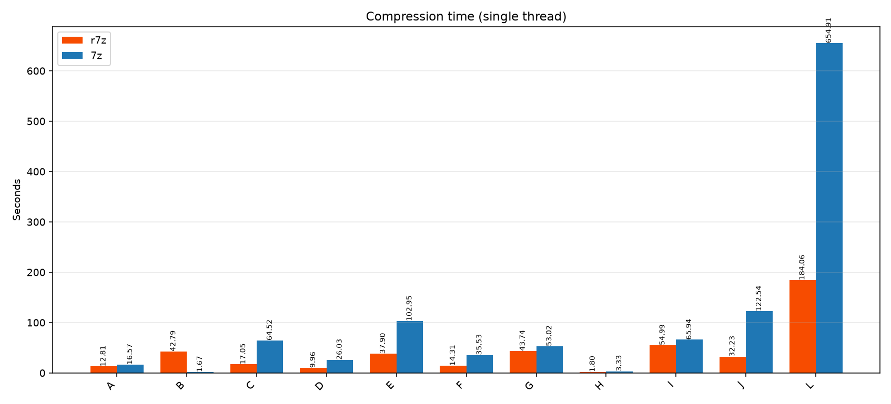
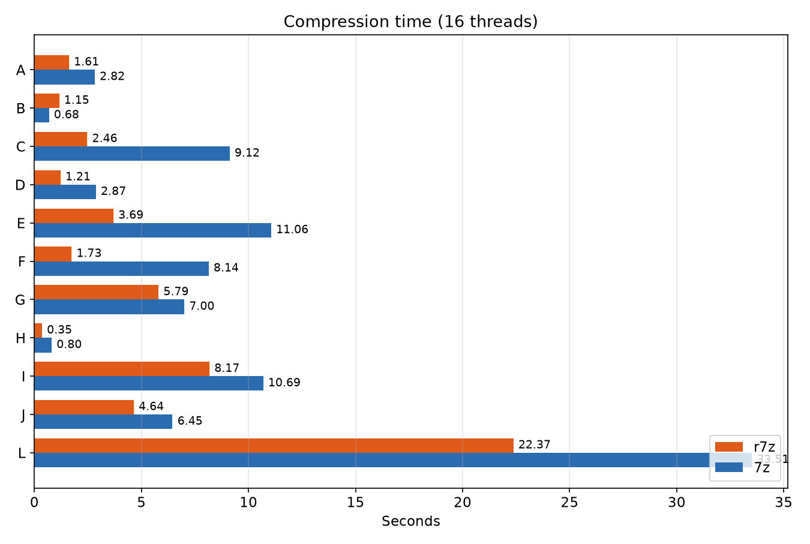
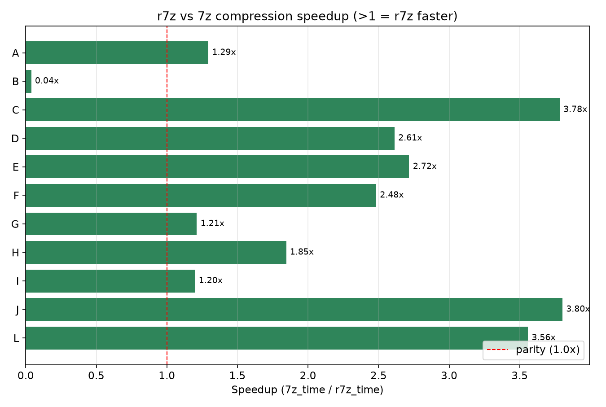
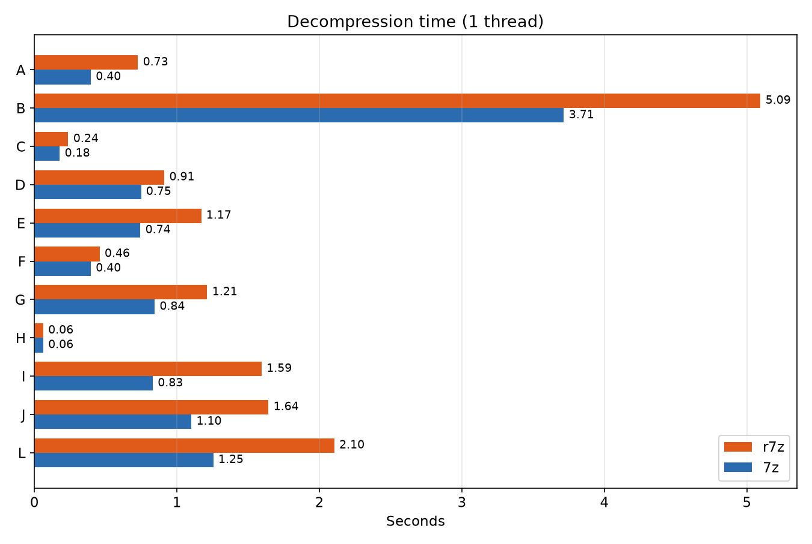
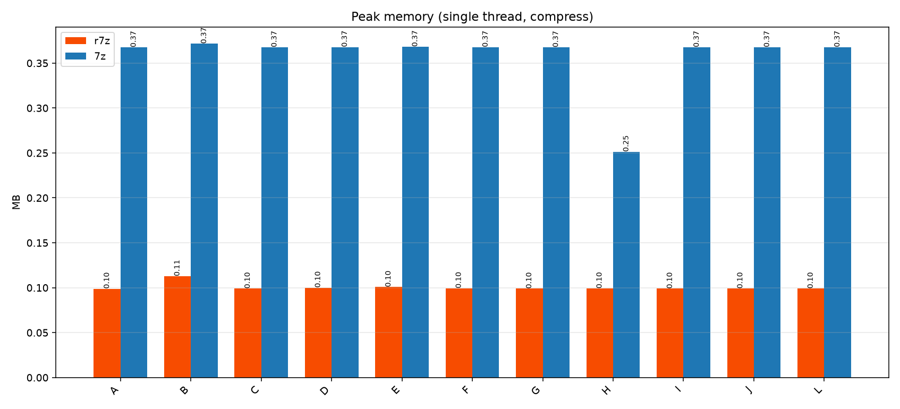

# r7z

> 7-Zip 코어(`a` / `x` 명령)의 Rust 재구현판. 원본 C/C++ `7z`와의 성능 비교를 위해 제작되었습니다.

[](https://github.com/WhAnci/r7z/actions)
[](LICENSE)
[](https://www.rust-lang.org)

**언어:** [English](README.md) (기본) · 한국어 · [中文](README.zh.md)


---

## 트레이드오프 (r7z vs 7-Zip)

| | r7z (Rust) | 7-Zip (C++) |
|---|---|---|
| **속도 (대용량 텍스트, 1스레드)** | ~12.8s | ~16.6s |
| **속도 (대용량 텍스트, 16스레드)** | ~1.6s | ~2.6s |
| **속도 (소형 파일 다수)** | 느림 (~42s) | 빠름 (~1.7s) |
| **피크 메모리 (1스레드)** | ~101 MB | ~376 MB |
| **피크 메모리 (16스레드)** | ~812 MB | ~1811 MB |
| **압축률** | 7z와 동등 | 기준 |
| **메모리 안전성** | 컴파일 타임 | 수동 관리 |
| **런타임 의존성** | 없음 (정적 바이너리) | 시스템 라이브러리 |
| **크로스 플랫폼 빌드** | `cargo build` | 플랫폼별 |
| **크래시 안전성** | `panic=abort` | 잘못된 입력에서 가능 |

> **요약:** r7z는 대용량/비압축 데이터에서 더 빠르고 메모리를 2-4배 적게 씁니다.
> 소형 파일 다수 처리에서는 7-Zip이 여전히 우세합니다. [벤치마크 리포트](benchmark_report.md) 참고.

---

## 기능

- `a` — 파일/디렉터리를 `.7z` 아카이브에 추가
- `x` — 아카이브 해제
- `l` — 아카이브 메타데이터 목록
- `t` — 아카이브 무결성 테스트
- 압축 레벨 `-m 1..9` (별칭 `--mx`)
- 스레드 수 `-t N` (0 = 모든 코어, 별칭 `--mmt`)
- 비밀번호 암호화 `-p <password>`
- 자동 확인 `-y`
- 셸 자동완성: `r7z completions <bash|zsh|fish|powershell>`
- `indicatif` 기반 진행률 표시
- `rayon` 기반 병렬 파일 스캔

## 프로젝트 구조

```
r7z/
├── Cargo.toml
├── src/
│ └── main.rs
├── scripts/
│ ├── gen_testdata.py
│ └── benchmark.py
├── docs/
│ └── optimization.md
├── .github/workflows/ci.yml
├── .cargo/config.toml
├── benchmark_report.md
├── LICENSE
└── README*.md
```

## 빠른 시작

```bash
# 빌드
cargo build --release

# 압축
./target/release/r7z a out.7z ./mydir -m 9 -t 8

# 해제
./target/release/r7z x out.7z -o extracted/ -t 8

# 목록
./target/release/r7z l out.7z
```

Windows: `target\release\r7z.exe`.

## 벤치마크

```bash
python scripts/gen_testdata.py # generates testdata/A,B,C
python scripts/benchmark.py # writes benchmark_report.md
```

시나리오 (11개, 전체 결과는 benchmark_report.md 참고):
- **A** — 500 MB 고압축 가능 텍스트
- **B** — 10,000개 소형 파일 (1-10 KB)
- **C** — 200 MB 비압축 랜덤
- **D** — 200 MB 소프트웨어 패키지 (바이너리)
- **E** — 472 MB 게임 에셋
- **F** — 213 MB 사용자 백업
- **G** — 1 GB 장기 보관 (레벨 9)
- **H** — 22 MB 이메일/공유 번들
- **I** — 1 GB SQL 덤프
- **J** — 1 GB VM 디스크 이미지
- **L** — 2 GB 단일 대용량 파일

측정 항목: 벽시계 시간, 아카이브 비율, 피크 RSS, 단일 vs 멀티스레드.

자세한 결과: [benchmark_report.md](benchmark_report.md)













## 빌드 요구사항

- Rust 1.75+ (`rustup`)
- (Windows) MSVC Build Tools
- Python 3.10+ (스크립트용)
- 7-Zip (비교용)

## 벤치마크 요약 (단일 스레드, 압축)

| 시나리오 | r7z 시간 | 7z 시간 | r7z 메모리 | 7z 메모리 | r7z 비율 | 7z 비율 |
|---|---|---|---|---|---|---|
| A 대용량 텍스트 (500MB) | 12.8s | 16.6s | 101MB | 376MB | 0.02% | 0.02% |
| B 소형 파일 (10k) | 42.8s | 1.7s | 116MB | 381MB | 0.28% | 0.28% |
| C 랜덤 (200MB) | 17.1s | 64.5s | 101MB | 377MB | 100% | 100% |
| D 소프트웨어 (200MB) | 10.0s | 26.0s | 102MB | 377MB | 50% | 50% |
| E 게임 에셋 (472MB) | 37.9s | 102.9s | 103MB | 377MB | 78% | 78% |
| F 사용자 백업 (213MB) | 14.3s | 35.5s | 102MB | 377MB | 51% | 50% |
| G 장기 보관 (1GB) | 43.7s | 53.0s | 101MB | 376MB | 0.02% | 0.02% |
| H 이메일/공유 (22MB) | 1.8s | 3.3s | 102MB | 257MB | 100% | 100% |
| I SQL 덤프 (1GB) | 55.0s | 65.9s | 101MB | 377MB | 0.02% | 0.02% |
| J VM 이미지 (1GB) | 32.2s | 122.5s | 101MB | 377MB | 50% | 50% |
| L 초대용량 (2GB) | 184.1s | 654.9s | 101MB | 377MB | 100% | 100% |

> r7z는 대용량 텍스트/비압축/혼합 데이터에서 7z보다 빠르고 메모리는 2-4배 적습니다.
> 7z는 소형 파일 다수 처리(B)에서 여전히 우세합니다.


## 라이선스

MIT — [LICENSE](LICENSE).