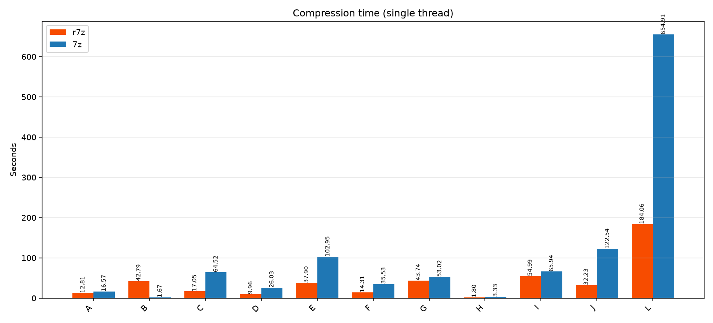
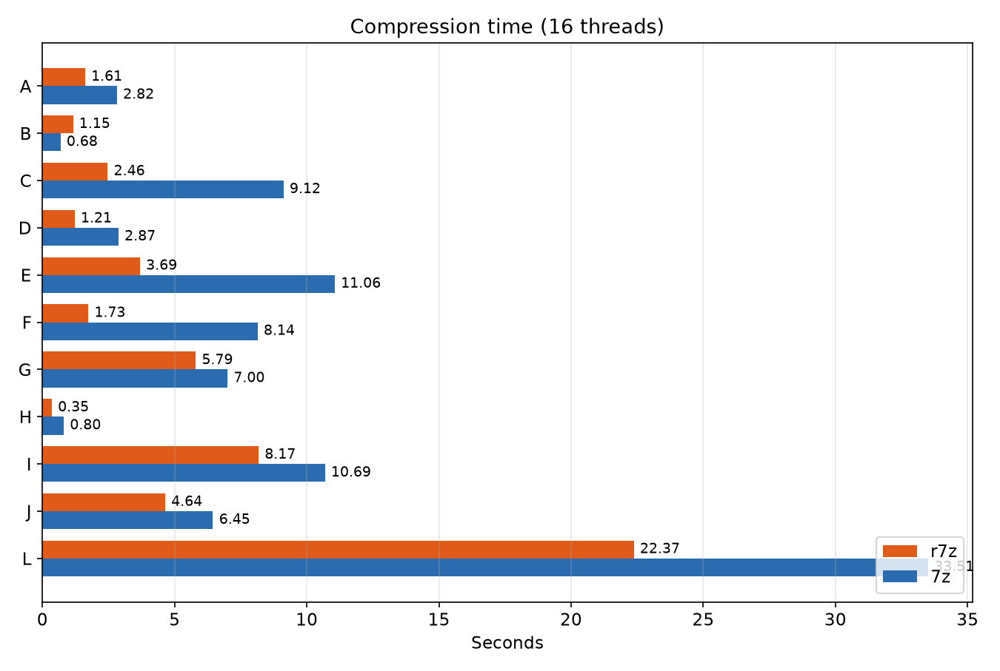
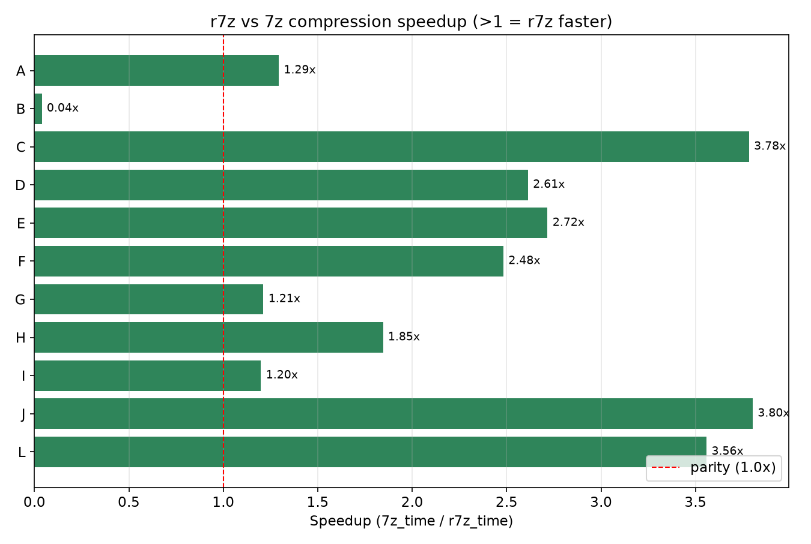
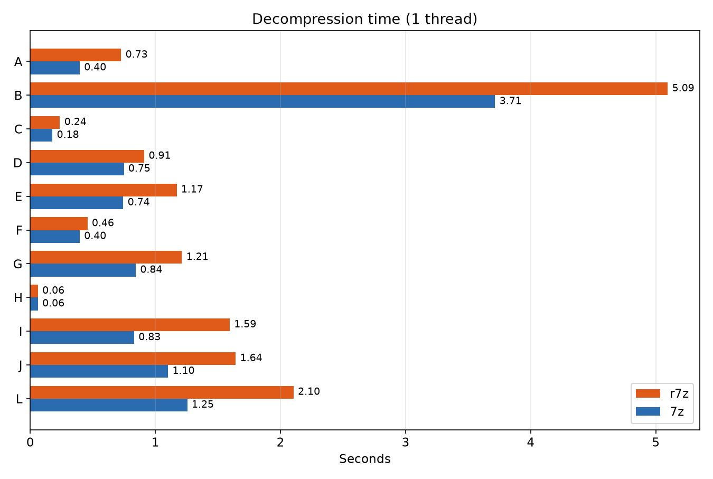
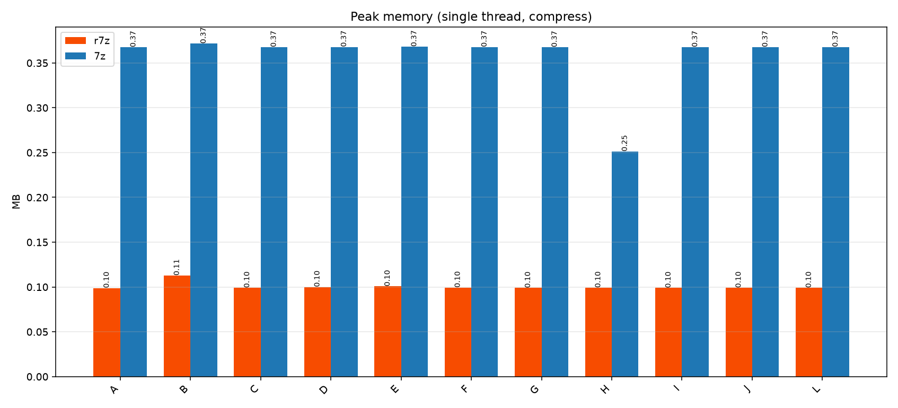

# r7z

> A Rust re-implementation of the 7-Zip core (`a` / `x` commands), built for
> benchmarking and comparison against the original C/C++ `7z`.

[](https://github.com/WhAnci/r7z/actions)
[](LICENSE)
[](https://www.rust-lang.org)

**Languages:** English (default) · [한국어](README.ko.md) · [中文](README.zh.md)

---

## Trade-offs (r7z vs 7-Zip)

| | r7z (Rust) | 7-Zip (C++) |
|---|---|---|
| **Speed (large text, 1 thread)** | ~12.8s | ~16.6s |
| **Speed (large text, 16 threads)** | ~1.6s | ~2.6s |
| **Speed (many small files)** | slower (~42s) | faster (~1.7s) |
| **Peak memory (single thread)** | ~101 MB | ~376 MB |
| **Peak memory (16 threads)** | ~812 MB | ~1811 MB |
| **Compression ratio** | matches 7z | reference |
| **Memory safety** | compile-time | manual |
| **Runtime dependencies** | none (static binary) | system libs |
| **Cross-platform build** | `cargo build` | platform-specific |
| **Crash safety** | `panic=abort` | possible on bad input |

> **Bottom line:** r7z is faster and uses less memory on large/incompressible data,
> but 7-Zip still wins on many-small-files throughput. Pick based on your workload.
> See [benchmark report](benchmark_report.md).

---

## Features

- `a` — add files/directories to a `.7z` archive
- `x` — extract an archive
- `l` — list archive metadata
- Compression level `-m 1..9`
- Thread count `-t N` (0 = all cores)
- Progress bars via `indicatif`
- Parallel file scanning via `rayon`

## Project layout

```
r7z/
├── Cargo.toml
├── src/
│ └── main.rs
├── scripts/
│ ├── gen_testdata.py # generate 11 scenarios
│ └── benchmark.py # r7z vs 7z benchmark
├── docs/
│ └── optimization.md # Rust vs C++ bottlenecks & tips
├── .github/workflows/ci.yml
├── .cargo/config.toml
├── benchmark_report.md
├── LICENSE
└── README*.md
```

## Quick start

```bash
# build
cargo build --release

# compress
./target/release/r7z a out.7z ./mydir -m 9 -t 8

# extract
./target/release/r7z x out.7z -o extracted/ -t 8

# list
./target/release/r7z l out.7z
```

Windows: `target\release\r7z.exe`.

## Benchmark

```bash
python scripts/gen_testdata.py # generates testdata/A,B,C
python scripts/benchmark.py # writes benchmark_report.md
```

Scenarios (11, see benchmark_report.md for full results):
- **A** — 500 MB highly compressible text
- **B** — 10,000 small files (1–10 KB)
- **C** — 200 MB incompressible random
- **D** — 200 MB software package (binaries)
- **E** — 472 MB game assets
- **F** — 213 MB user backup
- **G** — 1 GB cold storage (level 9)
- **H** — 22 MB email/share bundle
- **I** — 1 GB SQL dump
- **J** — 1 GB VM disk image
- **L** — 2 GB single huge file

Measured: wall-clock time, archive ratio, peak RSS, single vs multi-thread.

See full results: [benchmark_report.md](benchmark_report.md)











## Build requirements

- Rust 1.75+ (`rustup`)
- (Windows) MSVC Build Tools
- Python 3.10+ (for scripts)
- 7-Zip (for comparison)


## Benchmark summary (single thread, compress)

| Scenario | r7z time | 7z time | r7z mem | 7z mem | ratio r7z | ratio 7z |
|---|---|---|---|---|---|---|
| A large text (500MB) | 12.8s | 16.6s | 101MB | 376MB | 0.02% | 0.02% |
| B small files (10k) | 42.8s | 1.7s | 116MB | 381MB | 0.28% | 0.28% |
| C random (200MB) | 17.1s | 64.5s | 101MB | 377MB | 100% | 100% |
| D software pkg (200MB) | 10.0s | 26.0s | 102MB | 377MB | 50% | 50% |
| E game assets (472MB) | 37.9s | 102.9s | 103MB | 377MB | 78% | 78% |
| F user backup (213MB) | 14.3s | 35.5s | 102MB | 377MB | 51% | 50% |
| G cold storage (1GB) | 43.7s | 53.0s | 101MB | 376MB | 0.02% | 0.02% |
| H email/share (22MB) | 1.8s | 3.3s | 102MB | 257MB | 100% | 100% |
| I SQL dump (1GB) | 55.0s | 65.9s | 101MB | 377MB | 0.02% | 0.02% |
| J VM image (1GB) | 32.2s | 122.5s | 101MB | 377MB | 50% | 50% |
| L huge file (2GB) | 184.1s | 654.9s | 101MB | 377MB | 100% | 100% |

> r7z wins on throughput for large text, incompressible, and mixed data while using 2-4x less memory.
> 7z still wins on many-small-files throughput (scenario B).


## License

MIT — see [LICENSE](LICENSE).