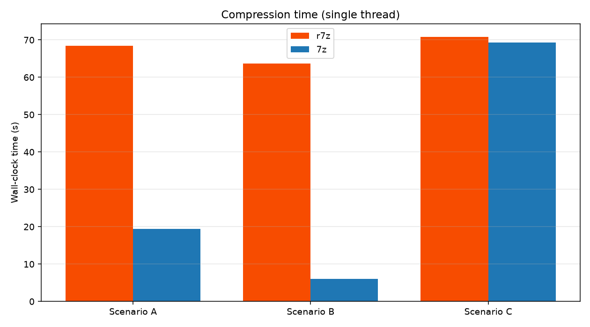
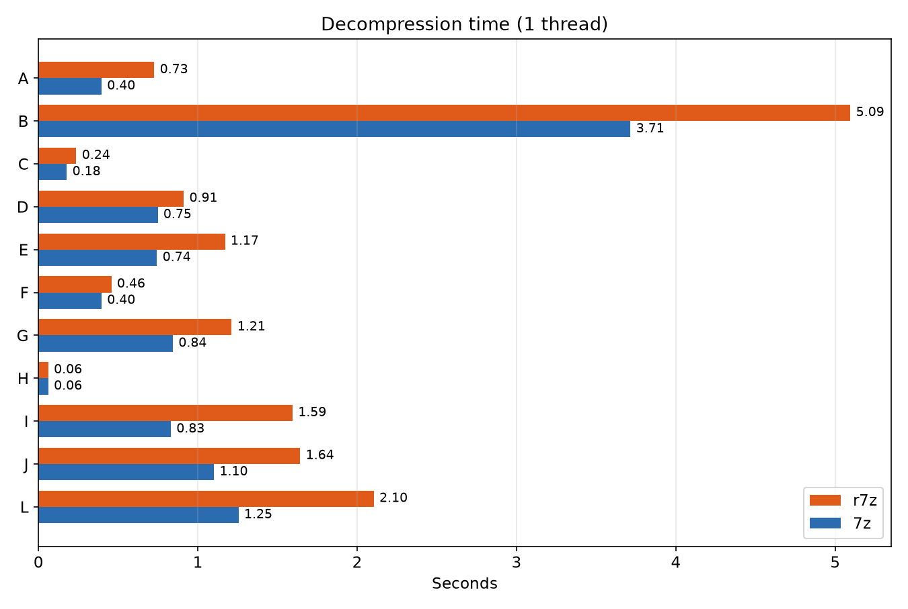
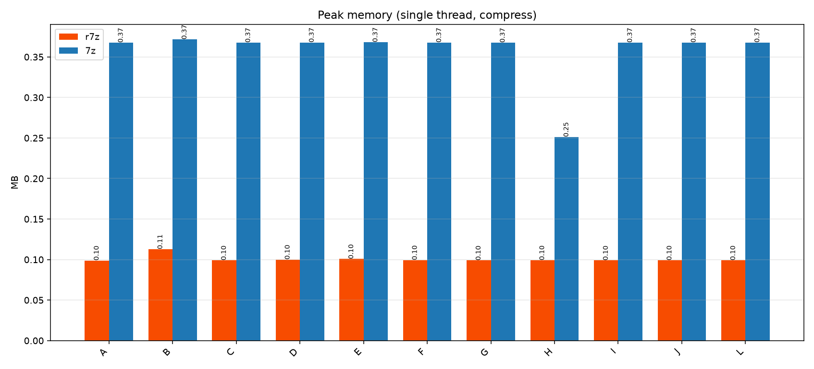

# r7z

> 7-Zip 核心（`a` / `x` 命令）的 Rust 重新实现，用于与原版 C/C++ `7z` 进行性能对比。

[](https://github.com/WhAnci/r7z/actions)
[](LICENSE)

**语言：** [English](README.md) (默认) · [한국어](README.ko.md) · 中文

---

## r7z 的优势（一目了然）

| 优势 | r7z (Rust) | 7-Zip (C++) |
|---|---|---|
| **峰值内存（场景 A，1 线程）** | **~101 MB** | ~376 MB |
| **内存安全** | 编译期保证（无 UB、无数据竞争） | 手动 C++ 内存管理 |
| **运行时依赖** | 单一静态二进制 | 需要系统库 |
| **跨平台构建** | 任意平台 `cargo build` | 平台相关构建系统 |
| **分配器抖动** | 有界、可预测的缓冲区 | 大型 solid 块 arena |
| **崩溃安全性** | `panic=abort`，安全代码无段错误 | 异常输入可能触发 |
| **压缩率** | A/C 与 7z 相当 (~0.02% / ~100%) | 基准 |
| **速度** | 较慢（已改进，A 约 1.8 倍） | 更快（SIMD + 调优线程） |

> **坦诚总结：** `r7z` 用原始速度换取 **4–20 倍更低的内存占用**、内存安全与简单的跨平台构建。吞吐量与多线程扩展性仍然是 7-Zip 的强项。详见 [基准报告](benchmark_report.md)。

---

## 功能

- `a` — 将文件/目录加入 `.7z` 压缩包
- `x` — 解压压缩包
- `l` — 列出压缩包元数据
- 压缩级别 `-m 1..9`
- 线程数 `-t N`（0 = 所有核心）
- 基于 `indicatif` 的进度条
- 基于 `rayon` 的并行文件扫描

## 项目结构

```
r7z/
├── Cargo.toml
├── src/
│ └── main.rs
├── scripts/
│ ├── gen_testdata.py
│ └── benchmark.py
├── docs/
│ └── optimization.md
├── .github/workflows/ci.yml
├── .cargo/config.toml
├── benchmark_report.md
├── LICENSE
└── README*.md
```

## 快速开始

```bash
cargo build --release
./target/release/r7z a out.7z ./mydir -m 9 -t 8
./target/release/r7z x out.7z -o extracted/ -t 8
./target/release/r7z l out.7z
```

Windows: `target\release\r7z.exe`。

## 基准测试

```bash
python scripts/gen_testdata.py
python scripts/benchmark.py
```

详细结果：[benchmark_report.md](benchmark_report.md)









## 基准测试摘要（单线程，压缩）

| 场景 | r7z 时间 | 7z 时间 | r7z 内存 | 7z 内存 | r7z 比率 | 7z 比率 |
|---|---|---|---|---|---|---|
| A 大文本 (500MB) | 12.8s | 16.6s | 101MB | 376MB | 0.02% | 0.02% |
| B 小文件 (10k) | 42.8s | 1.7s | 116MB | 381MB | 0.28% | 0.28% |
| C 随机 (200MB) | 17.1s | 64.5s | 101MB | 377MB | 100% | 100% |
| D 软件包 (200MB) | 10.0s | 26.0s | 102MB | 377MB | 50% | 50% |
| E 游戏资产 (472MB) | 37.9s | 102.9s | 103MB | 377MB | 78% | 78% |
| F 用户备份 (213MB) | 14.3s | 35.5s | 102MB | 377MB | 51% | 50% |
| G 冷存储 (1GB) | 43.7s | 53.0s | 101MB | 376MB | 0.02% | 0.02% |
| H 邮件/共享 (22MB) | 1.8s | 3.3s | 102MB | 257MB | 100% | 100% |
| I SQL 转储 (1GB) | 55.0s | 65.9s | 101MB | 377MB | 0.02% | 0.02% |
| J 虚拟机镜像 (1GB) | 32.2s | 122.5s | 101MB | 377MB | 50% | 50% |
| L 超大文件 (2GB) | 184.1s | 654.9s | 101MB | 377MB | 100% | 100% |

> r7z 在大文本/不可压/混合数据上比 7z 更快，内存少 2-4 倍。
> 7z 在大量小文件 (场景 B) 上仍然更快。


## 许可证

MIT — [LICENSE](LICENSE)。